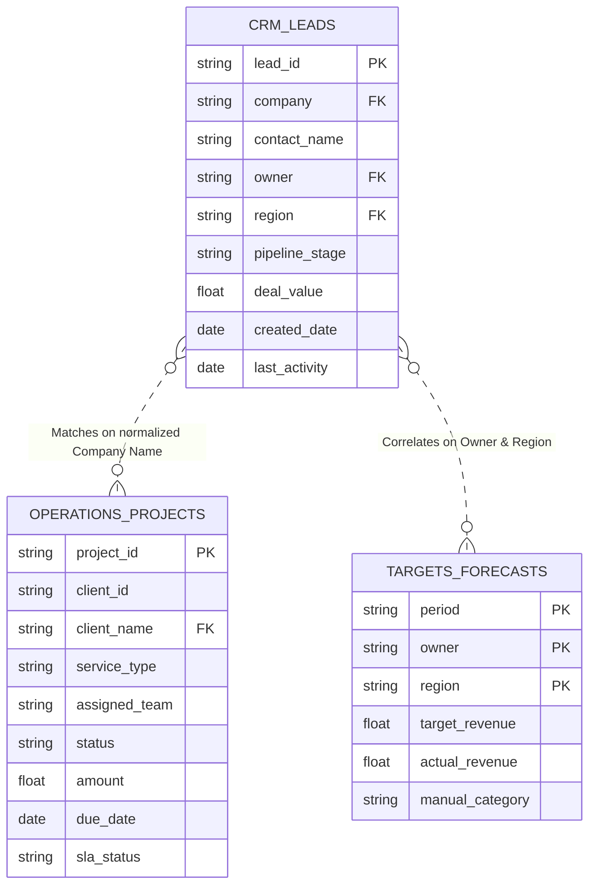

# Data Dictionary & KPI Calculation Rules

**Document Version:** 1.0.0  
**Project:** Sales & Operations Intelligence Dashboard (Braahmam International Limited)  
**Author:** Candidate Assignment Submission  

---

## 1. Data Sources Overview

The prototype integrates data from three simulated business sources:
1. **CRM Leads (`crm_leads.csv`)**: Captures prospective deals, top-of-funnel activity, pipeline stages, lead owners, and deal amounts.
2. **Operations Projects (`operations_projects.json`)**: Tracks operational delivery, project timelines, assigned delivery teams, budgets, and SLA adherence.
3. **Targets & Forecasts (`targets_forecasts.csv`)**: Represents Google Sheets management planning documents, containing monthly quotas, forecast revisions, and actual revenues.

---

## 2. Comprehensive Data Dictionary

### 2.1 CRM Leads (`crm_leads.csv`)
- **Total Records:** 500  
- **Primary Key:** `lead_id`  

| Field Name | Type | Nullable | Description & Domain | Sample Values |
|---|---|---|---|---|
| `lead_id` | String | No | Unique lead identifier (`LEAD-XXXX`) | `LEAD-0001`, `LEAD-0245` |
| `contact_name` | String | No | Full name of the prospect/contact | `Sarah Johnson`, `David Miller` |
| `email` | String | No | Contact email address | `s.johnson@company.com` |
| `company` | String | Yes (~5%) | Prospect company name (Title Cased) | `CloudNova Inc`, `Apex Dynamics` |
| `source` | String | No | Marketing or acquisition channel | `LinkedIn`, `Referral`, `Website`, `Trade Show` |
| `owner` | String | No | Sales representative managing the lead | `Sarah Johnson`, `Mike Chen`, `Priya Patel` |
| `pipeline_stage` | String | No | Current sales stage in the funnel | `New Lead`, `Contacted`, `Qualified`, `Proposal Sent`, `Negotiation`, `Closed Won`, `Closed Lost` |
| `deal_value` | Numeric | Yes (~8%) | Estimated contract value in USD (5,000–500,000) | `145000.00`, `28500.50` |
| `created_date` | Date | No | Lead creation timestamp (ISO `YYYY-MM-DD`) | `2024-03-15`, `2025-01-20` |
| `last_activity` | Date | Yes | Most recent interaction timestamp (`YYYY-MM-DD`) | `2024-11-02`, `2025-08-14` |
| `status` | String | No | Lifecycle status (`Active`, `Inactive`, `Converted`) | `Active`, `Converted` |
| `region` | String | No | Target market region | `North America`, `Europe`, `Asia Pacific`, `Middle East`, `Latin America` |

### 2.2 Operations Projects (`operations_projects.json`)
- **Total Records:** 300  
- **Primary Key:** `project_id`  

| Field Name | Type | Nullable | Description & Domain | Sample Values |
|---|---|---|---|---|
| `project_id` | String | No | Unique operational project ID (`PRJ-XXXX`) | `PRJ-0001`, `PRJ-0150` |
| `client_id` | String | No | Client account reference (`CLT-XXX`) | `CLT-010`, `CLT-045` |
| `client_name` | String | No | Client company name (used for cross-source join) | `CloudNova Inc`, `Horizon Digital` |
| `service_type` | String | No | Nature of service delivered | `Implementation`, `Consulting`, `Support`, `Migration`, `Integration` |
| `status` | String | No | Project progress state | `Open`, `In Progress`, `Completed`, `Overdue`, `On Hold`, `Cancelled` |
| `created_date` | Date | No | Project inception date (`YYYY-MM-DD`) | `2024-02-10`, `2025-04-12` |
| `due_date` | Date | No | Contractual project deadline (`YYYY-MM-DD`) | `2024-05-30`, `2025-08-15` |
| `completed_date` | Date | Yes | Date work was finished (null for open/overdue) | `2024-05-28`, `null` |
| `amount` | Numeric | No | Contract project value in USD | `67369.25`, `185000.00` |
| `assigned_team` | String | No | Internal execution team | `Team Alpha`, `Team Beta`, `Team Gamma`, `Team Delta`, `Team Omega` |
| `sla_status` | String | No | Service Level Agreement compliance status | `Within SLA`, `At Risk`, `Breached` |
| `priority` | String | No | Operational urgency level | `Low`, `Medium`, `High`, `Critical` |

### 2.3 Targets & Forecasts (`targets_forecasts.csv`)
- **Total Records:** 117  
- **Primary Key:** (`period`, `owner`, `region`) composite  

| Field Name | Type | Nullable | Description & Domain | Sample Values |
|---|---|---|---|---|
| `period` | String | No | Monthly financial period (`YYYY-MM`) | `2024-01` through `2025-09` |
| `owner` | String | No | Assigned sales representative | `Sarah Johnson`, `Mike Chen` |
| `region` | String | No | Operating region | `North America`, `Europe` |
| `account_segment`| String | No | Target customer tier | `Enterprise`, `Mid-Market`, `SMB`, `Strategic` |
| `target_revenue` | Numeric | No | Planned revenue target in USD | `250000.00`, `180000.00` |
| `forecast_revenue`| Numeric | No | Rolling forecasted revenue in USD | `240000.00`, `195000.00` |
| `actual_revenue` | Numeric | Yes | Closed revenue (null for future months > 2025-06)| `262000.00`, `null` |
| `manual_category`| String | No | Qualitative health assessment | `On Track`, `At Risk`, `Below Target`, `Exceeded` |
| `reference_values`| String | Yes | Management notes / revision rationale | `Board approved`, `Q1 adjusted` |
| `campaign_mapping`| String | Yes | Marketing campaign attribution | `Spring Campaign`, `Q4 Blitz` |

---

## 3. Entity Relationships & Join Strategy

### Join & Matching Assumptions:
1. **Sales to Operations Linkage:**
   - **Join Key:** Case-insensitive, whitespace-trimmed company name (`crm_leads.company` = `operations_projects.client_name`).
   - **Rationale:** Operational and CRM systems in mid-market organizations frequently do not share unified client UUIDs prior to an enterprise MDM (Master Data Management) initiative. Company name fuzzy/normalized matching is the standard bridge.
   - **Unmatched Handling:**
     - 30 companies match identically across both systems.
     - 20 CRM companies have no operational projects (prospects who haven't bought yet or closed lost).
     - 20 Operations clients have no CRM leads (legacy clients onboarded before current CRM instance).
     - Unmatched records are never discarded; they are segregated into the **Data Quality** portal.

2. **Targets to Sales Linkage:**
   - Linked via canonical sales rep `owner` and geographical `region`.

---

## 4. KPI Calculation Rules & Business Logic

### 4.1 Sales KPIs
- **Total Leads:**
  $$\text{Total Leads} = \sum \text{Count}(\text{lead\_id})$$
- **Lead Conversion Rate (%):**
  $$\text{Conversion Rate} = \frac{\text{Count}(\text{stage} \in [\text{'Closed Won'}])}{\text{Total Leads}} \times 100$$
  *Current Value:* $8.60\%$
- **Total Pipeline Value ($):**
  $$\text{Pipeline Value} = \sum \text{deal\_value} \quad \text{where } \text{stage} \notin [\text{'Closed Won'}, \text{'Closed Lost'}]$$
- **Average Deal Size ($):**
  $$\text{Avg Deal Size} = \frac{\sum \text{deal\_value}}{\text{Count}(\text{deal\_value} \text{ IS NOT NULL})}$$
- **Stale Leads Definition:**
  Leads where `status = 'Active'` and `last_activity < (Reference Date - 90 days)`.

### 4.2 Operations KPIs
- **Total Projects:**
  $$\text{Total Projects} = \sum \text{Count}(\text{project\_id})$$
- **Open Projects:**
  $$\text{Open Projects} = \text{Count}(\text{status} \notin [\text{'Completed'}, \text{'Cancelled'}])$$
- **Overdue Projects:**
  $$\text{Overdue Projects} = \text{Count}(\text{status} = \text{'Overdue'})$$
  *(Current Value: 40 projects / 13.33% of portfolio)*
- **SLA Compliance Rate (%):**
  $$\text{SLA Compliance} = \frac{\text{Count}(\text{sla\_status} = \text{'Within SLA'})}{\text{Count}(\text{sla\_status} \text{ IS NOT NULL})} \times 100$$
  *(Current Value: 37.0%)*

### 4.3 Management Targets vs Actuals
- **Achievement Percentage (%):**
  $$\text{Achievement Rate} = \frac{\text{actual\_revenue}}{\text{target\_revenue}} \times 100$$
  - Flagged as `Critical` if achievement $< 70\%$
  - Flagged as `Warning` if achievement $< 80\%$
  - Future periods (months after 2025-06) display targets only, as actuals have not closed yet.
