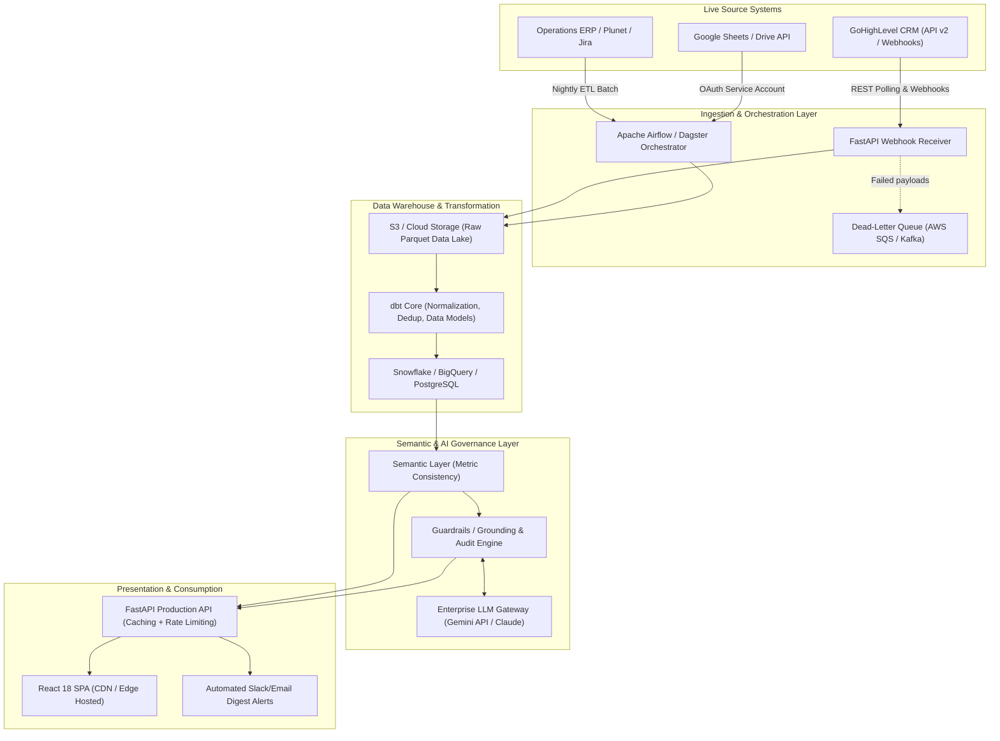
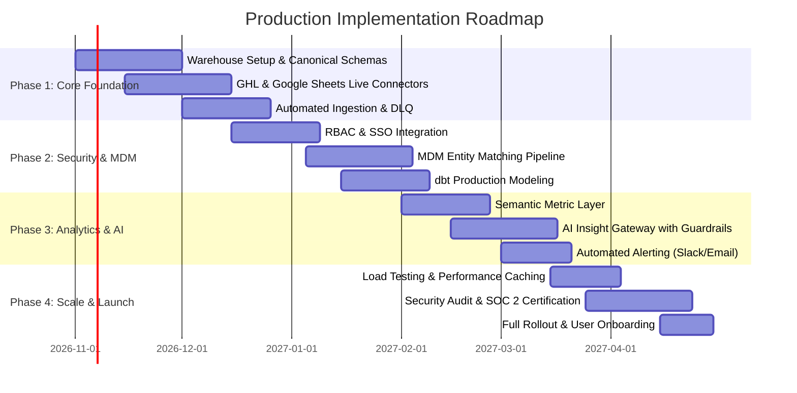

# Production-Readiness Vision & Engineering Roadmap

**Document Version:** 1.0.0  
**Project:** Sales & Operations Intelligence Dashboard (Braahmam International Limited)  
**Author:** Technical Architecture Submission  

---

## 1. Executive Summary

This prototype successfully proves the analytical, visual, and AI-assisted value of consolidating disparate Sales, Operations, and Planning data. To transition from this 2-day scoped prototype into a mission-critical, enterprise-grade internal platform, this document outlines the end-to-end production architecture, security safeguards, governance frameworks, and execution roadmap.

---

## 2. High-Level Enterprise Architecture

---

## 3. Detailed Component Architecture & Integration Realities

### 3.1 Source System Integrations
1. **GoHighLevel (GHL) CRM Integration:**
   - **Authentication:** OAuth 2.0 with automated token refresh cycles using secure AWS Secrets Manager / HashiCorp Vault.
   - **Ingestion Strategy:** Hybrid approach:
     - *Real-time Webhooks:* Listen for `OpportunityStageUpdate`, `ContactCreate`, and `TaskCompleted` events.
     - *Scheduled Reconciliation:* Hourly incremental sync via `/opportunities/search` using `updated_at >= :last_sync_timestamp`.
   - **Rate Limit Handling:** GHL enforces rate limits (e.g., 100 requests / 10 seconds). Implement Leaky Bucket rate limiters via Redis with exponential backoff and jitter.

2. **Operations System (Plunet / Jira / Custom):**
   - **Integration:** REST API with pagination cursor support, or direct CDC (Change Data Capture) via Debezium if hosted on a dedicated database.
   - **Incremental Updates:** Track `last_modified` and watermark timestamps to minimize compute overhead.

3. **Google Sheets / Management Context:**
   - **Integration:** Google Workspace Service Account with granular read permissions restricted to designated spreadsheet IDs.
   - **Validation:** Automatic schema validator ensuring named columns exist before ingesting to avoid silent formatting breakage.

---

### 3.2 Canonical Data Model & Identifier Reconciliation
In the prototype, matching relies on normalized company names. In production, we deploy a **Customer Master Data Management (MDM)** pipeline:
- **Canonical Organization Entity:** Assigns an immutable `canonical_account_id` (UUID).
- **Identity Resolution Engine:**
  - Exact match: Domain matching (`@company.com` from contact emails) and tax/business registration IDs.
  - Fuzzy match: Levenshtein distance & Jaro-Winkler string similarity with automated human-in-the-loop validation queue for scores between 0.80 and 0.95.
- **Audit Lineage:** Every row maintains source lineage (`source_system`, `source_id`, `ingested_at`, `dbt_job_id`).

---

### 3.3 Security, Privacy & Compliance (SOC 2 & GDPR)
1. **Role-Based Access Control (RBAC):**
   - **Sales Representatives:** Filtered view showing only their assigned leads, pipeline, and personal quota progress.
   - **Sales Managers / Ops Leads:** Team-level visibility, workload allocation, and SLA breach monitors.
   - **Executive / Admin:** Organization-wide KPIs, cross-system financial reconciliation, and configuration settings.
   - **Authentication:** Corporate SSO (Okta, Microsoft Entra ID, Google Workspace) with multi-factor authentication (MFA).

2. **Data Protection & Encryption:**
   - **At Rest:** AES-256 encryption across all database volumes, S3 buckets, and data warehouse partitions.
   - **In Transit:** TLS 1.3 enforced across all API endpoints and internal microservice communications.
   - **PII Safeguards:** Automated pseudonymization/masking of sensitive customer contact info (phone numbers, personal emails) in analytics environments.

3. **Audit Trails & Retention:**
   - Full immutable audit log tracking every user login, data refresh, filter view, and report export.
   - Automated retention policies enforcing deletion of inactive lead PII after 24 months in compliance with GDPR.

---

### 3.4 AI Governance & Safeguards Against Hallucination
The prototype implements deterministic rule-based algorithms for zero-hallucination accuracy. In production, LLM enhancement follows strict guardrails:
1. **Separation of Fact vs Inference:**
   - Raw aggregations and trend percentages are computed purely in deterministic SQL/Python before being passed to the LLM context.
   - LLMs are strictly prohibited from generating quantitative figures independently.
2. **Grounding & Traceability:**
   - Every generated textual insight must cite exact record identifiers or metric keys in its JSON response schema.
   - Clickable drill-downs allow users to inspect the underlying source records justifying the AI's conclusion.
3. **Guardrails & Evaluation:**
   - Input sanitization to prevent prompt injection.
   - Synthetic or sanitized metadata only: zero customer PII is ever transmitted to external model APIs.
   - Automated evaluation suite checking fact consistency against ground-truth metric values.

---

## 4. Phased Engineering Roadmap

| Phase | Duration | Core Deliverables | Indicative Effort | Key Risk & Mitigation |
|---|---|---|---|---|
| **Phase 1: Ingestion & Infrastructure** | 6 Weeks | Production Postgres/Snowflake instance, Airflow DAGs, GHL API & Google Sheets connectors, error handling | 2 Data Engineers, 1 Backend Dev | *API Rate Limits:* Implement Redis token-bucket throttling & webhook fallback. |
| **Phase 2: Security & Entity Matching** | 6 Weeks | RBAC with Okta SSO, dbt transformations, domain-based company entity matching, audit logging | 1 Security Eng, 1 Data Eng | *Unmatched Entities:* Build human review queue in internal dashboard. |
| **Phase 3: AI & Advanced Analytics** | 6 Weeks | Semantic layer, LLM insight generator with strict ground-truth linking, Slack/Email alert dispatchers | 1 AI/ML Eng, 1 Full-Stack Dev | *AI Hallucinations:* Restrict LLM to text summarization of deterministic metrics. |
| **Phase 4: Hardening & Go-Live** | 4 Weeks | Redis caching, end-to-end integration testing, SOC 2 compliance check, user documentation | 1 QA Eng, 1 DevOps, 1 PM | *Data Drift:* Automated schema drift alerts and daily reconciliation tests. |

---

## 5. Ongoing Maintenance & Estimated TCO

| Cost Category | Recommended Service | Monthly Estimate (USD) |
|---|---|---|
| Cloud Compute & Hosting | AWS ECS / Render (FastAPI + React) | \$120 – \$250 |
| Data Warehouse | Snowflake (X-Small) / Managed PostgreSQL | \$200 – \$450 |
| Ingestion & Orchestration | Astronomer Airflow or AWS MWAA | \$150 – \$300 |
| Redis Cache & Secrets | AWS ElastiCache + Secrets Manager | \$80 – \$150 |
| AI API Tokens (Sanitized) | Gemini 1.5 Flash / Claude 3.5 Sonnet | \$30 – \$80 |
| **Total Estimated Operating Cost** | | **\$580 – \$1,230 / month** |
