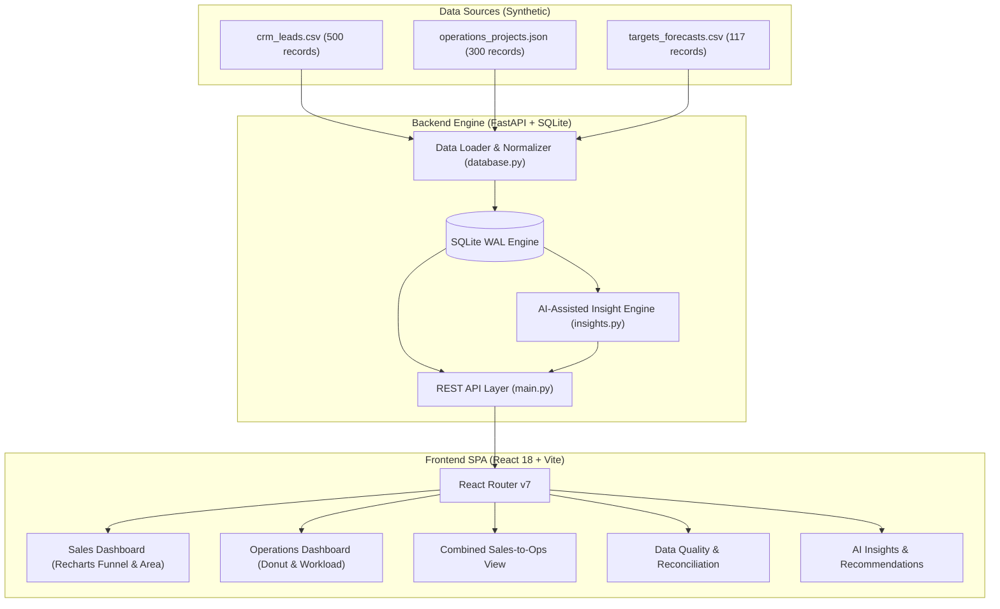

# Sales & Operations Intelligence Dashboard

A full-stack, enterprise-grade prototype combining Sales, Operations, and Management Target data into an unified intelligence dashboard with deterministic AI insights, cross-source entity matching, data quality reconciliation, and multi-dimensional filtering.

---

## 📌 Executive Summary & Problem Solved
In growing organizations, critical decisions are delayed because key data is fragmented across isolated silos:
- **Sales Data:** Resides in CRM systems (e.g., GoHighLevel) tracking top-of-funnel leads and deals.
- **Operations Data:** Held in project delivery platforms tracking milestones, workload, and SLA compliance.
- **Targets & Forecasts:** Stored in Google Sheets representing executive targets and manual category overrides.

This application provides a **repeatable, explainable, and automated** interface that reconciles these streams into a single pane of glass, surfaces revenue risks and SLA bottlenecks, and provides actionable recommendations.

---

## 🏗️ Architecture & Technology Stack



### Technology Rationale:
- **FastAPI (Python 3.10+):** Asynchronous, high-performance API framework with automated OpenAPI/Swagger documentation, native Pydantic schema validation, and fast calculation of statistical aggregations.
- **SQLite (WAL Mode):** Zero-configuration, file-based SQL engine with Write-Ahead Logging enabled, supporting atomic queries and high read concurrency without requiring external database servers during evaluation.
- **React 18 + Vite:** Instant hot-module replacement (HMR), minimal bundle size, and high-performance reactive UI rendering.
- **Tailwind CSS v4:** Utility-first, responsive, clean enterprise aesthetics with semantic status palettes.
- **Recharts:** Composable SVG charting with smooth transitions, responsive containers, and formatted tooltips.
- **Rule-Based AI Engine:** 100% deterministic, traceable insights with ground-truth linkage, preventing LLM hallucination while explaining exact mathematical justifications.

---

## 🚀 Quick Start & Local Setup Instructions

### Prerequisites
- **Python:** 3.10 or higher
- **Node.js:** v18 or higher (v20+ recommended)
- **npm:** v9 or higher

---

### Step 1: Clone & Navigate to Project
```bash
git clone <your-repository-url>
cd "sales & operations intelligence dashoard"
```

---

### Step 2: Set Up & Start Backend Server

```bash
cd backend

# 1. Install dependencies
pip install fastapi uvicorn pandas aiofiles python-multipart

# 2. (Optional) Re-generate synthetic data (already pre-generated)
python data/generate_data.py

# 3. Initialize SQLite database & start the backend API
python run.py
```
> The API will start at **`http://localhost:8000`**  
> Interactive OpenAPI documentation available at **`http://localhost:8000/docs`**

---

### Step 3: Set Up & Start Frontend Application

In a new terminal window:
```bash
cd frontend

# 1. Install frontend dependencies
npm install

# 2. Start the Vite development server
npm run dev
```
> The dashboard will open at **`http://localhost:5173`**

---

## 📊 Dashboard Views & Core Capabilities

| View | Purpose & Key Metrics | Primary Charts & Visuals |
|---|---|---|
| **1. Sales Dashboard** | Lead volume, conversion velocity, pipeline concentration, rep performance | Monthly Lead Velocity (AreaChart), Lead Source Share (PieChart), Pipeline Stage Funnel, Sales Rep Performance (Grouped Bar), Regional Distribution, Collapsible Stale Leads Table |
| **2. Operations Dashboard** | Project delivery health, team capacity, overdue project alerts, SLA tracking | Project Status Distribution (Donut), Inception Trend (LineChart), Team Capacity/Budget (BarChart), SLA Adherence (Donut), Service Type Distribution, Targets vs Actuals Comparison |
| **3. Combined View** | Cross-source account matching between CRM leads and Operations delivery | Matched Company Summary Cards, Multi-entity table showing CRM Deal Value, Ops Project Budgets, and Combined Account Valuation |
| **4. Data Quality** | Data transparency, missing value counts, duplicate detection, unlinked records | Source record tallies, Per-field missing value breakdowns, Unmatched entity isolation table, Last-loaded timestamp tracker |
| **5. AI-Assisted Insights** | Actionable recommendations grounded strictly in underlying dataset records | Severity-coded insight cards (Critical, Warning, Info) with expandable JSON data evidence and concrete next-step recommendations |

---

## 🧠 AI-Assisted Insights Engine
The engine continuously monitors the multi-source dataset and flags anomalous patterns:
1. **Pipeline Concentration:** Detects when $>40\%$ of pipeline value is bottlenecked in a single stage or owned by one sales rep.
2. **Stale Leads Alert:** Surfaces active leads with $>90$ days of inactivity, estimating potential unrealized revenue.
3. **Revenue at Risk:** Flags high-value opportunities in `Negotiation` without recent follow-up activity ($>30$ days).
4. **SLA Breach Trend:** Evaluates multi-month SLA compliance rates and triggers warnings when breaches trend upward.
5. **Overdue Projects:** Highlights specific delivery teams and service types carrying disproportional overdue project ratios.
6. **Target Gap Analysis:** Identifies sales reps and territories pacing $<80\%$ against monthly target revenues.
7. **Cross-Source Match Ratio:** Assesses account penetration between top-of-funnel CRM leads and active operational clients.

---

## 📁 Repository Structure
```
├── backend/
│   ├── data/
│   │   ├── crm_leads.csv            # 500 CRM Lead records
│   │   ├── operations_projects.json # 300 Operations Project records
│   │   ├── targets_forecasts.csv    # 117 Google Sheets targets & actuals
│   │   └── generate_data.py         # Deterministic synthetic data generator
│   ├── database.py                  # Schema definition, loaders & normalizers
│   ├── insights.py                  # AI analytical rule engine
│   ├── main.py                      # FastAPI REST routes with CORS & filters
│   ├── models.py                    # Pydantic schemas & response models
│   ├── requirements.txt             # Backend dependencies
│   ├── run.py                       # Startup script (db init + server launch)
│   └── test_endpoints.py            # Automated endpoint testing script
├── frontend/
│   ├── src/
│   │   ├── api/index.js             # Axios client mapped to backend endpoints
│   │   ├── components/              # KpiCard, ChartCard, DataTable, FilterBar, Layout
│   │   ├── pages/                   # Sales, Operations, Combined, DataQuality, Insights
│   │   ├── utils.js                 # Currency, number formatting, color constants
│   │   ├── App.jsx                  # React Router configuration
│   │   └── main.jsx                 # Application entry point
│   ├── package.json                 # Node dependencies & cross-platform scripts
│   └── vite.config.js               # Vite config with Tailwind & proxy
├── DATA_DICTIONARY_AND_KPIS.md      # Full Data Dictionary & calculation formulas
├── PRODUCTION_ROADMAP.md            # Vision, GHL integration, security & SOC2
└── README.md                        # Project documentation (this file)
```

---

## 📋 PRD Candidate Submission Checklist Verification

- [x] **Hosted Demo URL / Local Executable Verified:** Backend runs on `http://localhost:8000`, Frontend on `http://localhost:5173`.
- [x] **Git Repository & README Complete:** Full setup instructions, architecture summary, and component guide included.
- [x] **Synthetic Datasets & Data Dictionary Included:** CRM (500), Operations (300), Targets (117) with full field descriptions in `DATA_DICTIONARY_AND_KPIS.md`.
- [x] **Stack & Rationale Documented:** Justifications provided for FastAPI, SQLite, React 18, Vite, and Recharts.
- [x] **KPI Definitions & Data Mapping Explained:** Formulas, thresholds, and cross-source joins documented.
- [x] **At Least One AI Insight Demonstrated:** 7 distinct rule-based, data-grounded insights implemented with severity badges and recommendations.
- [x] **Production Roadmap Included:** Comprehensive 4-quarter roadmap covering GHL/Google Sheets APIs, RBAC, MDM, Airflow, and SOC 2 compliance in `PRODUCTION_ROADMAP.md`.
- [x] **Assumptions & Limitations Documented:** Reference date normalization, company fuzzy-matching constraints, and synthetic boundaries listed.
- [x] **Zero Company Data or Secrets Exposed:** 100% synthetic data, clean git hygiene with root `.gitignore`.
