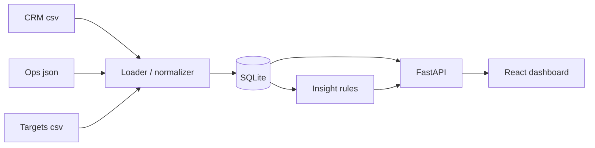

# Sales & Operations Intelligence Dashboard

This is my submission for the Braahmam International two-day assignment. It's a small dashboard that pulls together sales data (CRM), operations data (projects) and management targets (a Google Sheets-style file), cleans them up, matches accounts across them, and shows what's going on in one place.

Everything in here is made-up sample data. There's no real company, client or financial data anywhere in the repo, and it's a prototype, not something I'd put in front of real users as-is.

## What's in it

Three sources, each in a different format, to mimic the systems in the brief:

| Represents | File | Format | Rows |
| CRM (GHL-style) | `backend/data/crm_leads.csv` | CSV | 500 |
| Operations (Plunet-style) | `backend/data/operations_projects.json` | JSON | 300 |
| Google Sheets (targets and forecasts) | `backend/data/targets_forecasts.csv` | CSV | 117 |

`backend/database.py` loads all three into a SQLite database, normalizes the important fields, and the FastAPI backend serves the numbers to a React frontend. The data generator (`backend/data/generate_data.py`) uses a fixed seed, so you get the same files every time you run it.



## Why this stack

I wanted something that runs on a laptop with no setup and still looks like a real application.

- **FastAPI + pandas** for the backend. Quick to write, and the auto-generated `/docs` page is handy for checking the endpoints.
- **SQLite** because there's nothing to install. The downside is that it's single-user, so a real version would move to PostgreSQL or a warehouse.
- **React, Vite and Tailwind** for the UI, with **Recharts** for the charts. This does mean two things to host instead of one, which was a bit more work at deployment time.
- **Plain rule-based insights, no LLM.** I preferred insights I can trace back to specific rows over a model that might make things up. The trade-off is that they can only flag what I wrote rules for.

Hosting: TODO say where the API and frontend are deployed.

## Running it locally

You need Python 3.10+ and Node 18+.

```bash
git clone TODO-repo-url
cd TODO-folder-name
```

Backend:

```bash
cd backend
python -m venv .venv
source .venv/bin/activate        # on Windows: .venv\Scripts\activate
pip install -r requirements.txt

python data/generate_data.py     # optional, the files are already in the repo
python run.py                    # builds the database and starts the API
```

The API is at http://localhost:8000 and the docs are at http://localhost:8000/docs.

Frontend, in a second terminal:

```bash
cd frontend
npm install
npm run dev
```

Open http://localhost:5173.

There's also a quick check script for the endpoints: `python test_endpoints.py` from the `backend` folder.

## Refreshing the data

TODO: explain how a reload works (re-running `python run.py`, or a refresh button if you add one). The Data Quality page shows when the data was last loaded and how many rows came from each source.

Because the sample data is static, "today" for the stale-lead and overdue logic is fixed at TODO-date (shown on TODO-which-pages) so the numbers don't change depending on when you open it.

## The pages

- **Sales:** leads over time, leads by source, stage, owner and region, open pipeline, the stage funnel, and a list of stale leads.
- **Operations:** projects by status and over time, overdue and completed work, workload by team and service type, SLA status, and targets vs actuals.
- **Combined:** accounts that exist in both the CRM and operations data, with deal value next to project value.
- **Data Quality:** row counts per source, missing values by field, and the records that couldn't be matched.
- **Insights:** the flagged issues, each with the numbers behind it and a suggested next step.

Filters: TODO list the filters that actually work (date range, owner, source, region...). Say whether every chart on a page responds to them.

## How the sources are matched

The three systems don't share an ID. A lead ID, a client ID and a project ID are different things, so I don't join on any of them. Instead I match CRM `company` to operations `client_name` after lowercasing and trimming whitespace. TODO: say whether this is exact matching only or if there's fuzzy matching too.

On the sample data, 30 companies match, 20 CRM companies have no project (prospects, mostly), and 20 operations clients have no CRM lead (think older clients from before the CRM). I don't drop any of these. They show up on the Data Quality page.

Targets are linked to leads through owner and region.

## Data quality

- Missing company names (about 5% of leads) and missing deal values (about 8%): TODO say how each is handled.
- Duplicate leads: TODO say how they're detected and excluded, or delete this line and mention it under limitations.
- Unmatched accounts: listed, never hidden.

## KPI definitions

The full formulas are in [DATA_DICTIONARY_AND_KPIS.md](DATA_DICTIONARY_AND_KPIS.md). The short version:

- **Conversion rate:** Closed Won leads divided by all leads. Open leads are in the denominator, so recent months look worse than they will end up.
- **Open pipeline:** sum of `deal_value` for leads not yet won or lost. Leads with no deal value aren't in the sum.
- **Stale lead:** an active lead with no activity for more than 90 days before the reference date.
- **Overdue project:** TODO describe the rule you end up using.
- **SLA compliance:** projects marked "Within SLA" divided by projects that have an SLA status.
- **Target achievement:** TODO say what "actual" is based on.

Everything is in USD, so there are no mixed-currency totals. Dates are plain dates with no time zone.

## Insights

There are seven rules:

1. More than 40% of open pipeline sitting in one stage or with one owner
2. Active leads with no activity for 90+ days
3. Deals in Negotiation with no activity for 30+ days
4. SLA breaches trending up over the months
5. Overdue projects clustered in one team or service type
6. Owners or regions pacing below 80% of target
7. How many CRM accounts also show up in operations

Each card shows the metric and the rows behind it, plus what someone might check next. These aren't forecasts, and they don't explain why something happened. TODO: confirm facts and possible explanations are shown separately.

The thresholds (40%, 90 days, 30 days, 80%) are my own picks. They're not based on any real business rules.

## Data, privacy and AI

All data is synthetic and lives in a local SQLite file plus the CSV and JSON files in `backend/data/`. Nothing is sent to an external AI service or any other third party. There are no API keys or secrets in the project, and `.gitignore` is set up to keep any future `.env` files out of Git.

Things like access control, encryption, retention and audit logging aren't built. I wrote up how I'd handle them in [PRODUCTION_ROADMAP.md](PRODUCTION_ROADMAP.md).

## Where things stand

What works:

- Three synthetic sources with a generator and a data dictionary
- Loading and normalizing into SQLite
- The five pages above
- Account matching with unmatched records reported
- Seven rule-based insights
- A written production roadmap

What's missing or rough (TODO: edit this to match the final state):

- No year-over-year comparison yet
- No proper unit tests for the KPIs and joins, only the endpoint check script
- No fuzzy matching, so small spelling differences between systems would count as unmatched
- The sample data is pretty clean, so the data-quality handling doesn't get much of a workout
- Overdue is based on the project's `status` field rather than calculated from due dates (TODO: remove this line if you change it)

## Assumptions and known issues

Assumptions:

- Company name is the only workable link between CRM and operations data.
- All amounts are in USD.
- The targets file stands in for a manually kept Google Sheet.

Known issues:

- `actual_revenue` in the targets file is typed into the file, not calculated from CRM or operations records, so it may not line up with closed-won deals.
- SQLite won't handle several people writing at once.
- There's no login, roles, audit log, monitoring or backups.
- TODO: add any bugs you know about. A short honest list is better than none.

There are no AI or external API dependencies.

## Production roadmap

See [PRODUCTION_ROADMAP.md](PRODUCTION_ROADMAP.md) for how this would connect to GHL and Google Sheets, how syncing, access control, privacy, testing and AI safeguards would work, and a phased plan with risks and rough effort.

## Project layout

```
backend/
  data/                  sample files and generate_data.py
  database.py            schema, loaders, normalizing
  insights.py            insight rules
  main.py                API routes and filters
  models.py              response schemas
  run.py                 builds the database, starts the API
  test_endpoints.py      endpoint check script
frontend/src/            React pages, components, API client
DATA_DICTIONARY_AND_KPIS.md
PRODUCTION_ROADMAP.md
```